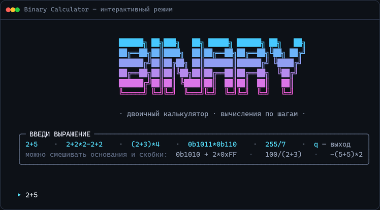
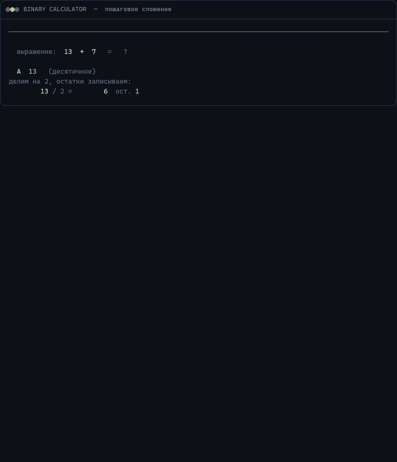
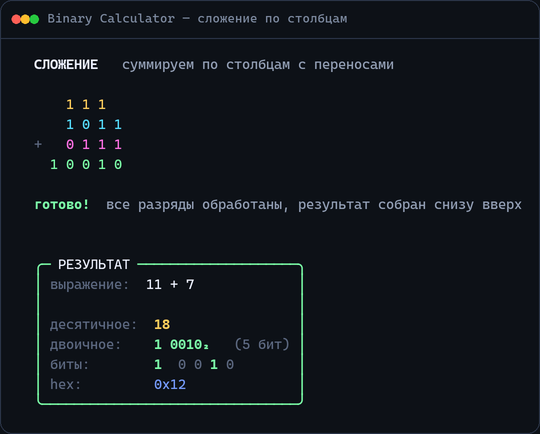
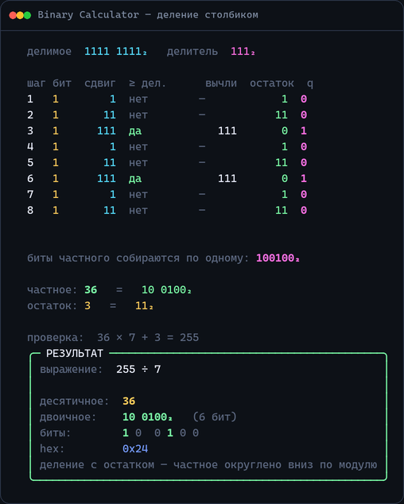
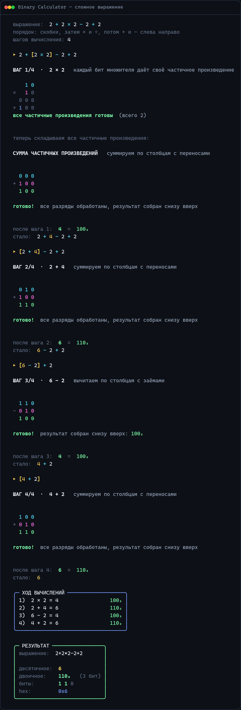

<div align="center">

# Binary Calculator

**Калькулятор для терминала Windows, который не просто считает, а показывает, как это происходит в двоичной системе.**
Вводишь `2+5` — и видишь сложение в столбик: разряды, переносы, биты. Без мгновенного ответа.

[](#требования)
[](#требования)
[](LICENSE)



</div>

---

## Что это

`Binary Calculator` — консольное приложение для Windows PowerShell с пошаговой
визуализацией арифметики в двоичной системе. Вместо готового ответа он рисует
сам процесс: как числа переводятся в двоичную, как складываются разряды, откуда
берутся переносы и заёмы, как получаются частичные произведения и частное.

Никаких зависимостей: только PowerShell, ANSI truecolor и символы псевдографики.
Работает и в Windows PowerShell 5.1, и в PowerShell 7+.



## Возможности

- **Четыре операции** с полной пошаговой анимацией:
  - `+` — сложение в столбик: строка переносов, подсветка текущего разряда,
    пояснение «1 + 1 + перенос 1 = 3₁₀ = 11₂ → пишем 1, переносим 1»;
  - `−` — вычитание с заёмами;
  - `×` — таблица частичных произведений и их пошаговое сложение;
  - `÷` — длинное деление: сдвиг, сравнение, вычитание, остаток.
- **Перевод чисел в двоичную наглядно**: для десятичных — таблица деления на 2
  с остатками, для `0b…` — разложение по степеням двойки.
- **Сложные выражения**: приоритеты операций, скобки, унарный минус —
  `2+2*2-2+2`, `(2+3)*4`, `100/(2+3)-0b1010`. Калькулятор строит план
  вычисления и анимирует каждый шаг по очереди.
- **Три системы счисления** в одном выражении: десятичная, двоичная (`0b`),
  шестнадцатеричная (`0x`).
- **Панель результата**: десятичное, двоичное с группировкой по нибблам,
  битовая карта, hex и дополнительный код для отрицательных чисел.
- **Журнал вычислений** — все промежуточные шаги с результатами в двоичном виде.
- **Адаптивная анимация** — длинные числа не заставляют ждать: скорость сама
  подстраивается под длину выражения.
- **Мягкая деградация** — если консоль не умеет ANSI, цвета и анимация
  отключаются, остаётся аккуратный текстовый вывод.

## Быстрый старт

1. Скачайте репозиторий (или только `BinaryCalc.ps1` и `BinaryCalc.cmd`).
2. Запустите двойным кликом **`BinaryCalc.cmd`**.

Либо вручную:

```powershell
powershell -ExecutionPolicy Bypass -File .\BinaryCalc.ps1
```

> **Совет:** запускайте в [Windows Terminal](https://aka.ms/terminal) — там
> корректно работают UTF-8, псевдографика и 24-битный цвет.

Внутри — цикл: вводите выражение, жмёте `Enter`, смотрите. `q` — выход.

## Что можно вводить

| Пример | Что это |
| :--- | :--- |
| `2+5` | десятичные числа |
| `0b1011*0b110` | двоичные (префикс `0b`) |
| `0xFF-0b1` | шестнадцатеричные (префикс `0x`) |
| `00101001+00101110` | тоже двоичные — ведущий ноль распознаётся |
| `255/7` | деление со столбиком и остатком |
| `2+2*2-2+2` | сложное выражение с приоритетами |
| `(2+3)*4` | скобки |
| `-(5+5)*2` | унарный минус |
| `100/(2+3)-0b1010` | смешивание систем счисления |

Операции: `+`, `-`, `*`, `/` (а также `x`, `×`, `÷`). Пробелы можно ставить
как угодно. Выход: `q`, `exit`, `выход`.

## Как это выглядит

### Сложение в столбик

Сверху — переносы, подсвечен текущий разряд, внизу — пояснение шага и
«осталось столбцов».



### Деление столбиком

Таблица шагов: сдвиг остатка, сравнение с делителем, вычитание и бит частного.



### Сложные выражения

Сначала строится план — какая под-операция идёт первой, — затем каждая
анимируется отдельно, а в конце показывается журнал всех шагов.

<details>
<summary><b>Скриншот полного разбора <code>2+2*2-2+2</code></b> (нажмите, чтобы раскрыть)</summary>



</details>

## Параметры запуска

| Параметр | Действие |
| :--- | :--- |
| `-Delay <мс>` | пауза между шагами анимации (по умолчанию `60`, `0` — без пауз) |
| `-Demo` | проиграть демонстрацию и выйти |
| `-Expression "<выражение>"` | посчитать одно выражение и выйти |
| `-ForceAnim` | рисовать анимацию даже при перенаправленном выводе |

```powershell
.\BinaryCalc.ps1 -Delay 20
.\BinaryCalc.ps1 -Expression "2+2*2-2+2"
.\BinaryCalc.ps1 -Demo
```

## Как это устроено

- **Произвольная точность.** Числа считаются через `System.Numerics.BigInteger`,
  а двоичная арифметика — над строками из `0`/`1`. Поэтому нет ограничения
  в 64 бита: `123456789*987654321` считается и рисуется полностью.
- **Парсер выражений.** Токенайзер → рекурсивный спуск → дерево разбора.
  Приоритеты: `×`/`÷` выше `+`/`−`, скобки, унарный минус. Дерево обходится
  в порядке вычисления, и каждый узел становится шагом анимации.
- **Кадры, а не `Clear-Host`.** Каждый кадр рисуется через ANSI
  (`ESC[2K` + `ESC[nA`), поэтому нет мерцания и прыжков экрана.
- **Цвета** — 24-битный truecolor (`ESC[38;2;R;G;Bm`). Поддержка VT включается
  через `SetConsoleMode`, а при её отсутствии интерфейс аккуратно
  переключается в монохромный режим без анимации.
- **Кодировка.** `.ps1` сохранён в UTF-8 **с BOM** — иначе Windows PowerShell
  читает кириллицу как мусор. `BinaryCalc.cmd` намеренно в ASCII: `cmd.exe`
  не понимает UTF-8 в batch-файлах.
- **Скорость.** Анимация масштабируется по длине числа: для 40-битной суммы
  паузы автоматически короче, чтобы не ждать минуту.

## Структура проекта

```
BinaryCalc.ps1   — весь калькулятор (парсер, арифметика, отрисовка)
BinaryCalc.cmd   — запускалка в один клик (обход ExecutionPolicy, UTF-8)
docs/            — скриншоты и демо-анимация для README
```

## Требования

- Windows 10 или Windows 11
- Windows PowerShell 5.1 либо PowerShell 7+
- терминал с поддержкой ANSI truecolor (рекомендуется Windows Terminal)

## Лицензия

[MIT](LICENSE) © 2026 Quartzglow
